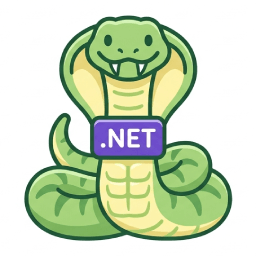

# Snek

[](https://github.com/Tyrrrz/.github/blob/prime/docs/project-status.md)
[](https://github.com/Tyrrrz/Snek/actions)
[](https://codecov.io/gh/Tyrrrz/Snek)
[](https://nuget.org/packages/Snek)
[](https://nuget.org/packages/Snek)
[](https://discord.gg/2SUWKFnHSm)

<table>
    <tr>
        <td width="99999" align="center">Development of this project is entirely funded by the community. <b><a href="https://tyrrrz.me/donate">Consider donating to support!</a></b></td>
    </tr>
</table>

<p align="center">
    
</p>

> **Made in 🇺🇦 Ukraine — [despite Russia's best efforts](https://tyrrrz.me/ukraine)**.
> Using this project or its source code comes with the implicit agreement that you condemn Russia's war of aggression against Ukraine, recognize Russia as a terrorist state, and support Ukraine's territorial integrity.

This is **Snek**, an MSBuild extension that automatically gives your assemblies a strong name.
This may be useful for library developers who wish to sign their binaries solely for compatibility reasons and prefer to avoid dealing with the Windows-only `sn.exe`.

## Install

- 📦 [NuGet](https://nuget.org/packages/Snek): `dotnet add package Snek`

## Usage

Simply install the **Snek** package as a private dependency in your project and it will automatically sign your assembly with a strong name:

```xml
<ItemGroup>
  <PackageReference Include="Snek" PrivateAssets="all" />
</ItemGroup>
```

You can then inspect the output assembly in **ILSpy** or a similar tool and see that it has a public key token:

```csharp
// Snek.Demo, Version=0.0.0.0, Culture=neutral, PublicKeyToken=af13e80e9703c96d
```

The strong name key pair is generated deterministically based on a seed, which is derived from the value of the `<PackageId>` or `<AssemblyName>` property, depending on which one is set.
You can also provide the seed yourself by explicitly setting `<AssemblyOriginatorKeySeed>` in your project file:

```xml
<PropertyGroup>
  <AssemblyOriginatorKeySeed>my-custom-seed</AssemblyOriginatorKeySeed>
</PropertyGroup>
```

## Etymology

**Snek** is a playful nickname for the `sn -k` command, which is traditionally used to generate a strong name key pair in .NET development.
